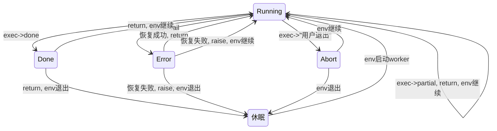

# NanoAI核心模块介绍

我们按照[智能体架构的五个层级](https://mp.weixin.qq.com/s/kxepzh1acttAANvDHMZfIQ)来组织和介绍核心功能模块。这些层级从低到高逐渐靠近业务，结构逐渐复杂。高层依赖于低层。

## 0. [工具包](./utils/__init__.py)

第0层提供通用工具。它们可以在智能体架构的各个层级使用。

**只有NanoAI库的核心开发者才需要关注这个层级。普通的智能体开发者不需要关注，也基本不会用到这里的内容**。

### [元概念模块](./utils/_concept_meta.py)

理解“概念”是构建结构化能力的第一步，也是最重要的一步。

这个模块定义和实现了“概念”。很简单，但已然有实用价值。

- 数据类**Concept**: 对于“概念”的实现。它和pydantic.BaseModel的语义很像。两者可以互相转换。它们的语言实现层级不一样。前者位于自然语言层，后者位于python层。

### [自然语言表达](./utils/nl_repr.py)

定义并提供了自然语言(和llm交互的语言)和python之间的转换功能。这是自然语言智能体编程的一个基础能力。

- 函数**nl_repr(obj) -> 自然语言描述**: 将任意python对象转换为人和语言模型可以阅读的描述。类似于python中的str，但语义层级更接近自然语言。

### [文字工具](./utils/text_utils.py)

提供了一些通用的文本和数据处理工具。是个大杂烩。

- 函数**df_to_html(pd.DataFrame) -> saved HTML file**: 将pandas表格转换为html的通用可视化工具。

### [Metric](./utils/metric.py)

定义了通用的“指标”概念。

- 类**DatumCriterion**: 描述“数据质量标准”的泛型基类，提供类型安全、异步等功能。

## 1.[语言模型](./model/__init__.py) (language model)

**该层的功能以及API都非常抽象，和业务没有直接关系。业务智能体开发不建议使用这一层。也无需了解。**

### [llm模块](./model/llm.py)

封装了OpenAI模型API，提供类型安全的结构化输出、流式输出、异步执行。这都是构建智能体系统重要的底层功能。

demo和测试代码见[test_llm.py](../tests/model/test_llm.py)。

### [type_tool模块](./model/_type_tool.py)

结构化输出能力的底层实现。

### [messages模块](./model/messages.py)

- 数据类**QAList**: 提供了对话数据的定义和功能，简单实用。可以和底层的model message格式作互相转换。

demo和测试代码见[test_messages.py](../tests/model/test_messages.py)

## 2.[原子任务/提示词](./task/__init__.py) (atom task/prompt)

业务层的原子任务定义和执行。

**这里的内容衔接了下面的模型层和上面的所有层。这是业务代码的基础。智能体开发者需要充分理解和掌握这里的内容。**

### [define模块](./task/define.py): 任务的定义。

Task是构建工作流和智能体的基石。它是整个库里最重要的概念，没有之一。

提供如下功能

- 数据类**Task**：最小单元通用任务的定义，包括简述、输入和输出的描述等字段。提供基础的模版功能。很容易使用、魔改和扩充。

demo和测试代码见[test_define.py](../tests/task/test_define.py)

### [meta模块](./task/_meta.py): 任务的“元”功能。

提供对于“任务”对象自身的一些“元”操作和工具。它们是一些高级功能的基础。

- 函数**generate_task(brief) -> Task**: 从任务的简要描述生成Task对象。
- 函数**validate_task(task) -> (valid, reasons)**: 验证一个Task对象的描述是否合理。
- 函数**reverse_criteria(task) ->reversed_task**：将一个任务改写为输出质量标准相反的任务。对于测试基本功能，构造测试数据有用。

demo和测试代码见[test_meta.py](../tests/task/test_meta.py)

### [engine模块](./task/engine.py): 任务的执行。

提供如下功能：

- 函数**execute(input, task, output_type) -> result**：最简单的使用语言模型来完成任务的API。对于很多任务够用了。
- 函数**execute_batch(input array, task array, async_mode) -> results of 2D array**: 在大量task上执行大量input。支持异步执行，速度快。重要实用功能。
- 类**LMWorker**：用语言模型完成任务的基类。没有对话状态管理，只能作单轮对话。功能远强于execute。（即将）支持：任意格式输入、输入合理性检查、输出合法性检查、错误处理等。实现足够简单。可以继承了魔改。

测试代码见[test_engine.py](../tests/task/test_engine.py)

### [eval模块](./task/eval.py): 通用测试功能。

提供如下功能：

- 函数**evaluate_dataset(dataset, metrics, async_mode) -> 关于(case, metric)的二维表格**: 计算dataset所有样本的所有metric结果，以及精度指标。支持异步，速度快。重要实用功能。

测试代码见[test_eval.py](../tests/task/test_eval.py)

### [common模块](./task/common.py): 重要通用的各种任务。

提供如下功能

- 函数**classify(input, categories, cls_action) -> (category, reason)**：“分类”是几乎一切知识体系的基础。这个函数也是大量高级功能的基础。
- 函数**judge(input, predicate) -> (Yes/No, reason)**：一种特殊的分类。对于输入做“是否”的判断。常见实用的功能。
- 函数**compare_judge(input1, input2, cmp_action) ->(Yes/No, reason)**: 和judge类似，输入为两个参数。

以上函数均提供异步版本。

demo和测试代码见[test_common.py](../tests/task/test_common.py)。

### [common_exp模块](./task/common_exp.py): 还不稳定的通用功能。

common模块的候选内容，还不成熟，处于实验阶段。不稳定。业务中不推荐直接使用，但可以copy了自己魔改。

提供以下功能

- 类**ConceptInstanceGenerator(concept, prompt) -> BaseModel**：给定任意概念和提示，生成其model class。非常基础的任务。目前很简单。值得增强功能和标准化。
- 类**TextComparer**：compare_judge的worker版本。目前很简单。值得增强功能和标准化。
- 函数**answer_with_cot(question) -> (answer, thinking_steps)**：对于输入的问题提供（答案，思考过程）。更多是个demo。不太清楚实际中怎么用。

### text(_exp)模块 (TODO)

提供文字处理的通用常用功能。

- 函数**summarization**: 文字总结
- 函数**extract**: 信息提取
- 函数**split**: 文本分割
- 函数**rephrase**: 不改变语义的文本改写

## 3. 工作流（workflow）TODO

复杂的任务拆解为多个单步任务的组合。控制逻辑由人工完成。

## 3.1[Chat工作流](./chat/__init__.py) (chat workflow)

chat是非常特殊而又重要的workflow。

### [define模块](./chat/define.py): 定义chat任务

提供如下功能：

- 类**ChatTask**: 对话任务的通用定义。相比于基础的通用任务，增加了关于“角色”和“人”的描述和控制。
- 类**ChatTaskGenerator**: 负责从自然语言描述生成ChatTask实例。这是“动态构建和组装Workflow/Agent”的基础。
- 类**UserProfileConceptGenerator**: 负责从自然语言描述生成用户画像概念。这是“灵活自动地构造对话数据”的基础。

demo和测试代码见[test_define.py](../tests/chat/test_define.py)

### [chat worker模块](./chat/worker.py): 单一任务对话

第一个足够复杂的模块，涉及到“人”，有状态管理、业务逻辑控制和跳转。提供如下功能：

- 类**ChatWorker**: 完成单一对话任务的基类。支持意图识别、状态管理、上下文管理等功能。迭代中，不稳定。在下文详述。

#### ChatWorker类详述（10%）

重要的基类。支持多轮对话智能体的各种通用功能。

运行过程中，其状态机如下

### [chat manager模块](./chat/manager.py): 多个任务对话

- 类**ChatManager**: 完成多个对话任务的基类，使用manager-worker模式。迭代中，不稳定。在下文详述。

#### ChatManager类详述（1%）

### [simulation模块](./chat/simulation.py): 对话生成

- 类**SimulatedChatUser**：通用的虚拟用户。这是“构造对话数据”的基础。使用UserProfileConceptGenerator。
- 函数**run_chat_cli(assistant worker, user worker) -> conversation data**：麻雀虽小五脏俱全的命令行聊天应用。支持三种用户输入类型：实时真实输入，预定义的输入，SimulatedChatUser的模拟输入。

demo和测试代码见[test_simulation.py](../tests/chat/test_simulation.py)。这里的内容有重要的学习和实践价值，包括

- 对话任务的控制和生成。
- 医疗领域的对话实例。
- 教育领域的对话实例。

## 4.智能体 (single agent)
complex task with llm-generated control flow

暂无。计划TODO:

### Tools模块

### Agent模块

## 5.多智能体系统(multiple agents)

过于复杂。超出认知。暂无计划。

## 重要组件（类、函数）总结

以下是部分重要组件的简要对比。

- 按照层级从低到高的顺序。
- 覆盖了各种维度: 输入，输出，业务，技术等。具有广泛的学习和参考价值。

|层级|   组件        | 输入 | 输出  |    业务用途    |        技术特性            |
|----|------------  |--------- |----------|----------------|----------------|
|Model|llm(_stream)   | str  | Any or Stream  | 不要直接用     |封装llm api, 无状态     |
|Task| execute    | str | Any    | 最简单的task API | simple wrapper of model |
|| classify     |    Any  |分类结果| 基础功能       |简单通用|
|| LMWorker     |    Any  | Any   | 通用基类       |面向业务单元task, 无状态|
||ConceptInstanceGenerator|Concept|object| 架构基础组件| 动态 |
||ChatTaskGenerator| str  | ChatTask |构建对话数据|   动态   |
|Chatflow|ChatWorker    | str |  Any  | 通用基类       |单一对话任务，复杂状态管理|
||SimulatedChatUser| str | str | 构建对话数据  | ChatWorker的继承和定制化|
|| ChatManager  |  str |  str  | 通用基类       |多个对话任务, 复杂状态管理|
