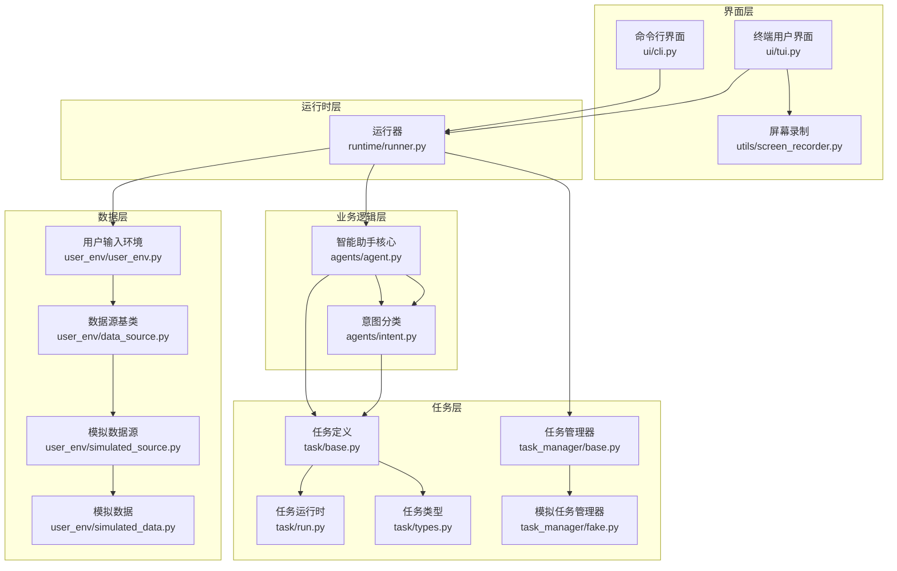

# 智能驾舱助手演示包设计文档

## 1. 包结构概览

本包是智能驾舱助手的演示实现，展示了如何构建一个基于意图分类的智能助手系统。包结构设计清晰，模块职责明确，便于理解和扩展。

```
projects/mind/demo/
├── agents/            # 智能助手模块
│   ├── __init__.py    # 智能助手组件导出
│   ├── agent.py       # 智能助手核心逻辑实现
│   └── intent.py      # 意图分类器实现
├── runtime/           # 运行时模块
│   └── runner.py      # 运行器，管理运行时环境和并发任务
├── ui/                # 用户界面模块
│   ├── cli.py         # 命令行界面入口
│   └── tui.py         # 终端用户界面入口
├── utils/             # 工具模块
│   └── screen_recorder.py # 屏幕录制工具
├── task/              # 任务定义和管理
│   ├── __init__.py    # 任务相关组件导出
│   ├── base.py        # 任务基础定义
│   ├── run.py         # 任务运行时定义
│   └── types.py       # 任务类型定义
├── task_manager/      # 任务管理器实现
│   ├── __init__.py    # 任务管理器导出
│   ├── base.py        # 任务管理器抽象接口
│   └── fake.py        # 模拟任务管理器实现
└── user_env/          # 用户输入环境
    ├── data_source.py        # 数据源基类
    ├── simulated_data.py     # 模拟数据定义
    ├── simulated_source.py   # 模拟数据源实现
    └── user_env.py           # 用户输入环境实现
```

## 2. 核心模块设计

### 2.1 架构层次

整个系统采用分层架构设计，从底层到上层依次为：

1. **数据层**：用户输入数据源 (`user_env/`)
2. **任务层**：任务定义和管理 (`task/`, `task_manager/`)
3. **业务逻辑层**：智能助手核心逻辑 (`agents/`)
4. **运行时层**：运行时环境和并发管理 (`runtime/`)
5. **界面层**：用户交互界面 (`ui/`)

### 2.2 模块关系图



## 3. 关键模块详解

### 3.1 运行器 (`runtime/runner.py`)

**核心职责**：
- 管理智能驾舱助手的运行时环境
- 处理并发任务（后台任务和流式任务）
- 管理用户输入和任务分发
- 提供任务状态跟踪和回调机制

**设计亮点**：
- 采用异步编程模型，使用 `asyncio` 实现并发处理
- 分离后台任务和流式任务，使用不同的处理机制
- 支持任务中断，新的流式任务可以打断正在执行的任务
- 提供详细的任务状态跟踪和摘要信息

### 3.2 智能助手核心 (`agents/agent.py`)

**核心职责**：
- 处理用户指令的核心业务逻辑
- 实现意图分类和聊天功能
- 支持流式响应生成

**设计亮点**：
- 支持 dummy 模式，便于测试和开发
- 模块化设计，可替换不同的意图分类器实现
- 采用流式响应机制，提供更好的用户体验

### 3.3 任务管理 (`task/` 和 `task_manager/`)

**核心职责**：
- 定义任务类型和分类
- 管理任务的生命周期
- 处理任务的提交和执行

**设计亮点**：
- 采用抽象接口设计，便于扩展不同的任务管理器实现
- 提供模拟任务管理器，便于测试和演示
- 支持任务状态跟踪和结果处理

### 3.4 用户输入环境 (`user_env/`)

**核心职责**：
- 管理用户输入队列
- 支持多种数据源
- 提供输入注入功能

**设计亮点**：
- 采用数据源抽象，支持不同的输入来源
- 提供模拟数据源，便于测试和演示
- 支持异步输入处理

## 4. 工程架构设计

### 4.1 框架设计

**设计原则**：
- **模块化**：每个模块职责单一，边界清晰
- **分层**：系统分为多个层次，每层职责明确
- **依赖注入**：通过构造函数注入依赖，减少耦合
- **抽象接口**：关键组件使用抽象接口，便于扩展

**核心流程**：
1. 用户输入通过 `UserEnv` 进入系统
2. `Runner` 从输入队列获取用户输入
3. `Agent` 对输入进行意图分类
4. 根据分类结果，将任务分发到后台任务或流式任务
5. 后台任务通过 `TaskManager` 管理执行
6. 流式任务通过 `chat_queue` 处理
7. 任务结果通过回调函数返回给用户

### 4.2 可扩展性设计

**扩展点**：
- **意图分类器**：可替换不同的意图分类实现，如基于规则、机器学习或深度学习
- **任务管理器**：可实现真实的任务管理器，对接外部系统
- **数据源**：可添加真实的用户输入数据源，如语音识别、文本输入等
- **智能助手核心**：可扩展更多的业务逻辑和功能

**扩展方式**：
- 通过实现抽象接口扩展功能
- 通过依赖注入替换组件
- 通过配置参数调整行为

### 4.3 可测试性设计

**测试友好特性**：
- **Dummy 模式**：支持 dummy 聊天和意图分类模式，便于测试
- **模拟数据源**：提供模拟数据源，可重现测试场景
- **模拟任务管理器**：模拟任务执行过程，便于测试任务流程
- **回调机制**：使用回调函数，便于测试结果验证

**测试策略**：
- 单元测试：测试各个模块的独立功能
- 集成测试：测试模块间的交互
- 端到端测试：测试整个系统的流程

### 4.4 性能优化

**优化策略**：
- **异步编程**：使用 `asyncio` 实现非阻塞IO，提高并发性能
- **任务分离**：将后台任务和流式任务分离，提高系统响应速度
- **轮询优化**：后台任务轮询使用合理的间隔，减少资源消耗
- **任务中断**：支持流式任务中断，提高用户体验

## 5. 使用指南

### 5.1 快速开始

**命令行界面**：
```bash
python ui/cli.py
```

**终端用户界面**：
```bash
python ui/tui.py
```

### 5.2 自定义扩展

**扩展任务管理器**：
1. 实现 `TaskManager` 抽象接口
2. 在创建 `AgentRunner` 时传入自定义任务管理器

**扩展数据源**：
1. 实现 `UserDataSource` 抽象接口
2. 在创建 `UserEnv` 时传入自定义数据源

## 6. 总结

本演示包展示了如何构建一个基于意图分类的智能驾舱助手系统，采用了现代软件工程的最佳实践：

- **清晰的分层架构**：便于理解和维护
- **模块化设计**：便于扩展和测试
- **异步编程**：提高系统性能和响应速度
- **抽象接口**：支持不同的实现方式
- **全面的文档**：便于开发者理解和使用

通过本包的学习，开发者可以了解智能助手系统的设计原理和实现方法，为构建更复杂的智能座舱系统打下基础。