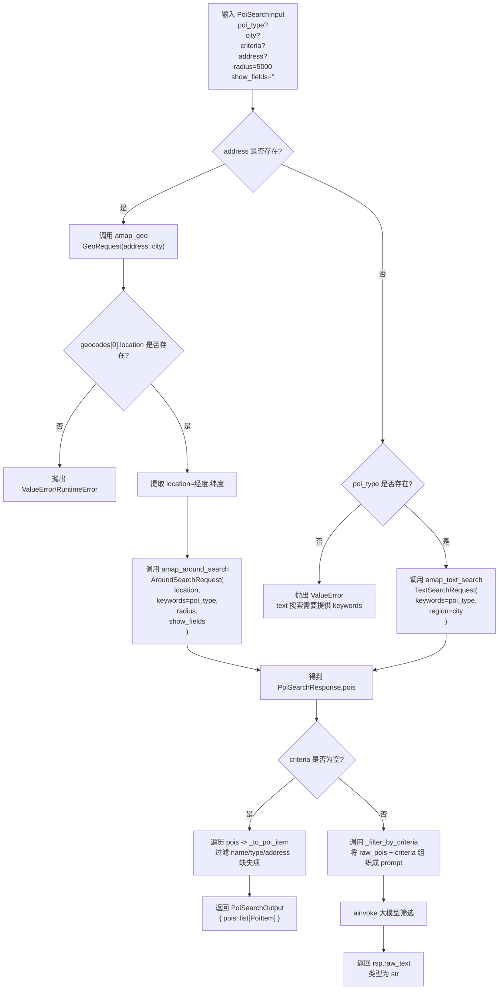
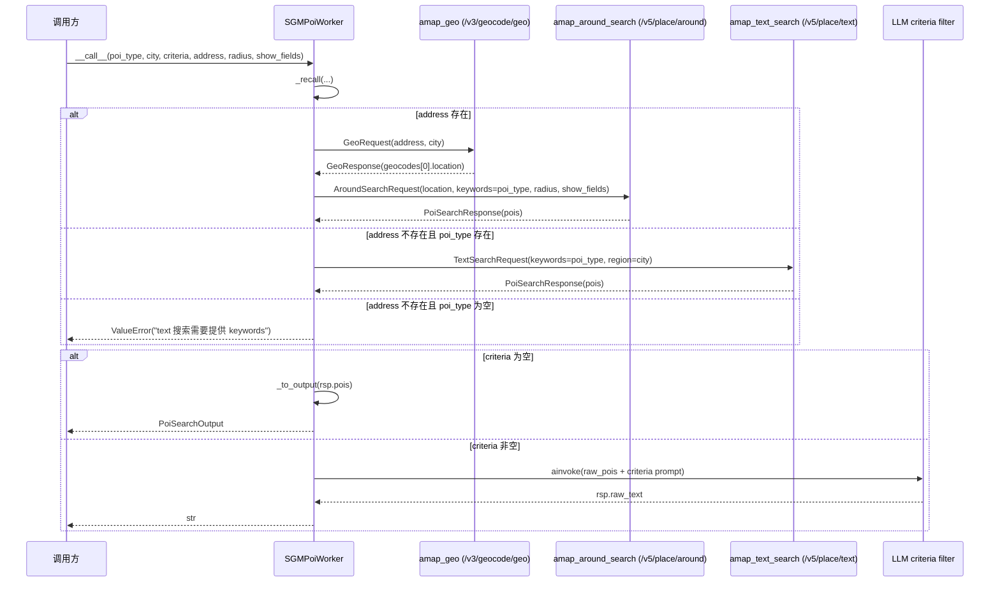

# SGMPoiWorker POI 搜索流程梳理

本文基于以下两部分信息整理：

- 高德 Web Service 相关文档
  - 旧版搜索 POI 文档：https://lbs.amap.com/api/webservice/guide/api-advanced/search#t4
  - 搜索 POI 2.0 文档：https://lbs.amap.com/api/webservice/guide/api-advanced/newpoisearch
  - 地理编码文档：https://lbs.amap.com/api/webservice/guide/api/georegeo
- 当前实现代码
  - [projects/mind/toolset/poi_search.py](/Users/WayneYu/yitu/project/nanoai/projects/mind/toolset/poi_search.py:104)
  - [projects/mind/toolset/amap.py](/Users/WayneYu/yitu/project/nanoai/projects/mind/toolset/amap.py:56)

需要注意的一点是：`SGMPoiWorker` 的业务思路可以参考旧版搜索 POI 文档来理解，但实际代码调用的是新版接口：

- 地理编码：`/v3/geocode/geo`
- 关键字搜索：`/v5/place/text`
- 周边搜索：`/v5/place/around`

## 总体逻辑

`SGMPoiWorker` 的处理可以拆成三段：

1. `text` 或 `geo + around` 二选一进行召回
2. 若无 `criteria`，直接做结构化结果转换
3. 若有 `criteria`，使用大模型对召回结果做二次筛选

也就是说，`criteria` 不是高德原子 API，而是召回之后的语义筛选层。

## 输入输出参数映射

### 工具输入

`PoiSearchInput` 定义如下：

- `poi_type: str | None`
- `city: str | None`
- `criteria: list[str] | None`
- `address: str | None`
- `radius: int = 5000`
- `show_fields: str = ""`

### 到高德原子 API 的映射

#### 1. address 存在时

先调用地理编码：

- `GeoRequest.address <- address`
- `GeoRequest.city <- city`

拿到 `location` 后再调用周边搜索：

- `AroundSearchRequest.location <- geo_rsp.geocodes[0].location`
- `AroundSearchRequest.keywords <- poi_type`
- `AroundSearchRequest.radius <- radius`
- `AroundSearchRequest.show_fields <- show_fields`

当前实现中，`city` 没有继续透传给 `AroundSearchRequest.region` 或 `city_limit`。

#### 2. address 不存在时

直接调用关键字搜索：

- `TextSearchRequest.keywords <- poi_type`
- `TextSearchRequest.region <- city`

当前实现里没有把外层 `show_fields` 传给 `TextSearchRequest`，因此 `text` 分支实际使用的是 `TextSearchRequest` 默认值 `business,photos`。

### 输出类型

输出是联合类型 `PoiSearchOutputLike = PoiSearchOutput | str`：

- 没有 `criteria` 时，返回 `PoiSearchOutput`
- 有 `criteria` 时，返回 `str`

其中 `PoiSearchOutput.pois` 中的字段来自内部精简后的 `PoiItem`：

- `type`
- `name`
- `address`
- `distance`
- `rating`
- `cost`

## 流程图



## 时序图



## 关键分支说明

### 1. `address` 优先级高于 `poi_type + city`

只要传入了 `address`，就优先进入：

- `geo(address, city)` -> `around(location, keywords=poi_type, radius, show_fields)`

这说明 `address` 在当前实现中扮演的是“确定搜索中心点”的角色，而不是普通过滤条件。

### 2. `text` 分支必须有 `poi_type`

如果没有 `address`，则必须提供 `poi_type`，否则 `_recall` 会直接抛出：

```python
ValueError("text 搜索需要提供 keywords")
```

### 3. `criteria` 会改变最终返回类型

- `criteria == []` 或 `None`：返回结构化 `PoiSearchOutput`
- `criteria` 非空：返回大模型筛选后的文本 `str`

这意味着上游调用方如果依赖结构化结果，需要明确控制 `criteria` 是否传入。

## 关键字段说明

高德原始返回会被 `projects/mind/toolset/amap.py` 中的 `PoiItem` 做一层标准化：

- `business.rating -> rating`
- `business.cost -> cost`
- `photos[0].url -> cover_url`

之后 `projects/mind/toolset/poi_search.py` 中 `_to_poi_item` 会再裁剪成更小的输出模型，只保留最终工具最关心的几个字段。

## 一句话总结

`SGMPoiWorker` 本质上是一个：

- 先做 POI 召回
- 再按需做语义筛选
- 最后根据是否有 `criteria` 返回结构化结果或自然语言结果

的组合式搜索工作流。
