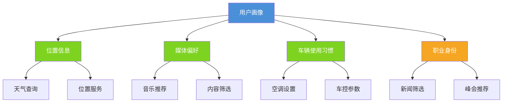

# 用户画像对Agent响应效果评测报告

## 一、评测概述

### 1.1 数据来源

- **数据路径**：`user_profile_reports\`
- **数据格式**：CSV文件
- **评测时间**：2026-03-24

### 1.2 前提条件说明

> ⚠️ **重要前提**

1. **数据筛选**：本评测数据从Planner数据集中随机挑选，已排除VQA相关query，因为该工具不存在于当前系统
2. **时间信息缺失**：提示词中未包含当前时间信息，导致部分时间相关query的响应存在不确定性
3. **当前具体位置缺失（非住处、公司地点）**：画像及提示词中未包含当前位置信息，故未测导航相关query

### 1.3 评测数据统计

| 画像类型   | 记录数     | 成功数     | 失败数   |
| ------ | ------- | ------- | ----- |
| 无画像    | 20      | 19      | 1     |
| 单身职场女性 | 20      | 20      | 0     |
| 退休银发族  | 20      | 20      | 0     |
| 创业青年   | 20      | 20      | 0     |
| 全职妈妈   | 20      | 19      | 1     |
| 商务精英   | 20      | 20      | 0     |
| **合计** | **120** | **118** | **2** |

### 1.3 评测维度

- **工具调用准确度**：评估工具选择的正确性和调用的适当性
- **合理性**：评估响应内容是否符合用户需求场景
- **上下文理解能力**：评估对用户上下文的理解程度
- **推理能力**：评估基于工具返回结果的推理过程
- **画像价值度**：评估画像信息对响应质量的提升程度

***

## 二、五类人群画像定义

### 2.1 单身职场女性

```python
UserProfile(
    user_type="单身职场女性",
    personal_status=["单身", "可能有稳定伴侣但未同居", "无子女"],
    residence="上海市浦东新区陆家嘴滨江住宅区（高端公寓）",
    career_identity=["互联网公司产品设计师/UI设计师", "工作地点：浦东新区世纪大道1000号"],
    daily_behavior=["通勤时间：07:00-09:00", "工作时间：09:00-18:00", "健身时间：18:00-20:00", "社交时间：20:00-24:00", "夜生活活跃"],
    personality_traits=["外向开放", "注重自我投资", "追求品质生活", "社交活跃", "文艺气质", "独立自主"],
    interests_hobbies=["独立音乐/民谣（网易云音乐）", "健身/瑜伽", "社交/夜生活", "购物/时尚", "旅行/摄影", "可能有宠物"],
    travel_pattern=["通勤占约25%", "社交购物娱乐占约75%", "以个人享受为中心的都市生活方式"],
    vehicle_usage=["空调温度均值25.2℃", "风量2.8档", "车控依赖度28%", "对舒适度较敏感"],
    media_preference=["网易云音乐占比32%", "流行音乐、独立音乐", "常听艺人：陈粒、苏打绿、告五人、田馥甄、房东的猫"]
)
```

### 2.2 退休银发族

```python
UserProfile(
    user_type="退休银发族",
    personal_status=["已退休", "老年夫妻居住", "子女已独立"],
    residence="上海闵行区古美街道（老小区）",
    career_identity=["已退休", "原工作单位不详"],
    daily_behavior=["晨练时间：05:00-07:00", "早餐/社区活动：07:00-09:00", "医院/购物：09:00-11:00", "午休：11:00-14:00", "社区活动：14:00-17:00", "休息时间：19:00-22:00"],
    personality_traits=["生活规律", "传统保守", "家庭观念强", "健康导向", "节俭务实", "技术接受度一般"],
    interests_hobbies=["评书/戏曲（喜马拉雅）", "公园晨练", "健康养生", "社区活动", "家庭聚餐"],
    travel_pattern=["去公园/菜市场占约77%", "医院占约13%", "子女家占约3%", "以日常生活和健康管理为中心"],
    vehicle_usage=["空调温度均值26.5℃", "风量2.2档", "车控依赖度45%", "偏好温暖环境", "使用习惯简单固定"],
    media_preference=["喜马拉雅占比48%", "评书、戏曲、健康养生", "常听内容：单田芳评书、京剧、黄梅戏、健康讲座"]
)
```

### 2.3 创业青年

```python
UserProfile(
    user_type="创业青年",
    personal_status=["单身", "无子女", "居住在合租公寓"],
    residence="上海徐汇区康健街道（合租公寓）",
    career_identity=["创业者/独立开发者/程序员", "工作地点：徐汇区漕河泾开发区创业孵化器"],
    daily_behavior=["深夜工作：00:00-02:00", "补觉：02:00-06:00", "通勤不固定", "工作时间：09:00-18:00", "继续工作：18:00-00:00", "作息不规律"],
    personality_traits=["目标导向", "冒险精神", "效率至上", "持续学习", "高成就动机", "健康意识一般"],
    interests_hobbies=["编程/技术", "科技播客/创业播客", "电子音乐", "创业生态活动", "游戏/电竞"],
    travel_pattern=["联合办公空间占约27%", "充电站占约76%", "客户/投资方占约12%", "以创业为中心的高强度生活方式"],
    vehicle_usage=["空调温度均值22.3℃", "风量3.5档", "车控依赖度52%", "温度波动大", "长时间在车内"],
    media_preference=["Apple Music+播客占比35%", "电子音乐、科技播客、编程音乐", "常听：Daft Punk、The Chemical Brothers、技术播客"]
)
```

### 2.4 全职妈妈

```python
UserProfile(
    user_type="全职妈妈",
    personal_status=["已婚", "有2名子女（6-9岁小学在读，3-5岁幼儿园）"],
    residence="上海浦东新区花木街道（中档小区）",
    career_identity=["全职妈妈", "无固定工作地点"],
    daily_behavior=["送孩子上学：06:30-08:00", "自由时间：08:00-12:00", "午餐/接孩子：12:00-14:00", "课外班：14:00-19:00", "家庭时间：19:00-22:00"],
    personality_traits=["计划性强", "责任感高", "奉献精神", "理性消费", "家庭优先"],
    interests_hobbies=["儿歌/儿童音乐", "育儿/教育", "购物/家庭采购", "妈妈群社交", "美容/健身", "亲子活动"],
    travel_pattern=["接送孩子和课外班占约33%", "购物占约53%", "以孩子和育儿为中心"],
    vehicle_usage=["空调温度均值24.8℃", "风量2.5档", "车控依赖度32%", "考虑孩子舒适度"],
    media_preference=["QQ音乐占比25%", "儿歌、轻音乐、流行", "常听：宝宝巴士、贝瓦儿歌、周杰伦、邓紫棋"]
)
```

### 2.5 商务精英

```python
UserProfile(
    user_type="商务精英",
    personal_status=["已婚", "子女在国际学校就读（8-15岁）", "家庭经济条件优越"],
    residence="上海静安区（顶级豪宅区）",
    career_identity=["金融企业中高层管理人员（总监/VP级别）", "工作地点：静安区南京西路1266号"],
    daily_behavior=["送孩子/通勤：06:00-08:00", "高层管理会议：08:00-12:00", "商务午餐：12:00-14:00", "客户会议：14:00-18:00", "商务应酬：18:00-20:00", "家庭时间：20:00-22:00"],
    personality_traits=["事业心强", "时间管理专家", "社会地位导向", "精英意识", "人脉资源丰富", "品质至上"],
    interests_hobbies=["财经新闻/商业播客", "高尔夫/高端运动", "商务社交", "艺术/文化", "高端旅行", "慈善/公益"],
    travel_pattern=["通勤和送孩子占约16%", "商务活动占约43%", "私人活动占约20%", "以商务和品质生活为中心"],
    vehicle_usage=["空调温度均值22.8℃", "风量2.9档", "车控依赖度28%", "可能有司机或助理操作"],
    media_preference=["QQ音乐占比18%", "古典音乐、爵士、商业播客", "常听：财经新闻、行业分析、商业案例"]
)
```

***

## 三、20个Query跨画像对比分析

### Query 1: 奇数拍的前卫摇滚有哪些名曲，我想挑两首赏析一下

| 画像类型   | 工具调用      | 响应特点                                                               | 画像价值 |
| ------ | --------- | ------------------------------------------------------------------ | ---- |
| 无画像    | websearch | 推荐King Crimson《21st Century Schizoid Man》和Pink Floyd《Money》，提供详细赏析 | 无    |
| 单身职场女性 | websearch | 同上，简洁推荐两首曲目                                                        | 低    |
| 退休银发族  | websearch | 同上，简洁推荐                                                            | 低    |
| 创业青年   | websearch | 推荐King Crimson和Yes的《Close to the Edge》                             | 低    |
| 全职妈妈   | websearch | 详细介绍两首曲目，包含专辑背景                                                    | 低    |
| 商务精英   | websearch | 简洁推荐，适合快速阅读                                                        | 低    |

**分析**：此query为专业知识查询，画像对响应影响较小，主要依赖websearch工具获取信息。

***

### Query 2: 外面晒不晒，看看要不要提起打开遮阳帘

| 画像类型   | 工具调用           | 响应特点                  | 画像价值  |
| ------ | -------------- | --------------------- | ----- |
| 无画像    | weather\_agent | **槽位缺失**，询问用户位置       | 无     |
| 单身职场女性 | weather\_agent | 直接查询浦东新区天气，告知小雨无需开遮阳帘 | **高** |
| 退休银发族  | weather\_agent | 直接查询闵行区古美街道天气，告知小雨    | **高** |
| 创业青年   | weather\_agent | 直接查询上海天气，告知小雨         | **高** |
| 全职妈妈   | weather\_agent | 直接查询浦东花木街道天气，告知小雨     | **高** |
| 商务精英   | weather\_agent | 直接查询上海静安区天气，告知小雨      | **高** |

**分析**：此query充分体现画像价值。无画像时因缺少位置信息导致槽位缺失，有画像时可直接使用画像中的居住地信息查询天气。

***

### Query 3: 我现在心情不太好，帮我放一些我喜欢听的歌曲

| 画像类型   | 工具调用                  | 响应特点                                  | 画像价值  |
| ------ | --------------------- | ------------------------------------- | ----- |
| 无画像    | media                 | 播放收藏的歌曲，通用响应                          | 无     |
| 单身职场女性 | music\_search + media | 播放独立音乐/民谣歌单（陈粒、苏打绿等）                  | **高** |
| 退休银发族  | music\_search + media | 播放黄梅戏曲目歌单                             | **高** |
| 创业青年   | music\_search + media | 播放Daft Punk和The Chemical Brothers电子音乐 | **高** |
| 全职妈妈   | music\_search + media | 播放周杰伦《晴天》                             | **高** |
| 商务精英   | music\_search + media | 播放古典与爵士曲风歌单                           | **高** |

**分析**：此query是画像价值体现最明显的场景。不同画像根据用户的媒体偏好推荐了完全不同风格的音乐：

- 单身职场女性 → 独立音乐/民谣
- 退休银发族 → 黄梅戏/戏曲
- 创业青年 → 电子音乐
- 全职妈妈 → 周杰伦（流行）
- 商务精英 → 古典/爵士

***

### Query 4: 搜搜最近的新的民谣，帮我找点我喜欢的播放

| 画像类型   | 工具调用                  | 响应特点               | 画像价值 |
| ------ | --------------------- | ------------------ | ---- |
| 无画像    | music\_search + media | 播放新民谣歌单            | 无    |
| 单身职场女性 | music\_search + media | 播放新民谣歌单            | 低    |
| 退休银发族  | music\_search + media | 播放《我记得》《碎银几两》      | 低    |
| 创业青年   | music\_search + media | 播放《我记得》《碎银几两》《郭源潮》 | 低    |
| 全职妈妈   | music\_search + media | 播放新民谣歌单            | 低    |
| 商务精英   | music\_search + media | 播放新民谣歌单            | 低    |

**分析**：此query明确指定了"民谣"风格，画像对响应影响较小。

***

### Query 5: 我最近追那个电视剧，有续集了吗

| 画像类型   | 工具调用      | 响应特点                        | 画像价值 |
| ------ | --------- | --------------------------- | ---- |
| 无画像    | websearch | 搜索"你追的电视剧续集消息"，未找到结果，询问具体剧名 | 无    |
| 单身职场女性 | websearch | 提供多部热门剧续集动态（《小巷人家2》等）       | 低    |
| 退休银发族  | websearch | 询问具体剧名                      | 低    |
| 创业青年   | 无工具调用     | 询问具体剧名                      | 无    |
| 全职妈妈   | websearch | 询问具体剧名                      | 低    |
| 商务精英   | websearch | 询问具体剧名                      | 低    |

**分析**：此query缺少具体剧名信息，画像无法提供有效补充，各画像响应相似。按理说应当直接询问，而不是通过websearch搜索。

***

### Query 6: 我想听点歌，别推那些乱七八糟的

| 画像类型   | 工具调用          | 响应特点                            | 画像价值  |
| ------ | ------------- | ------------------------------- | ----- |
| 无画像    | music\_search | 推荐热门歌曲歌单（周杰伦、邓紫棋等）              | 无     |
| 单身职场女性 | music\_search | 推荐独立音乐歌单                        | **高** |
| 退休银发族  | music\_search | 推荐经典戏曲歌单（黄梅戏）                   | **高** |
| 创业青年   | music\_search | 推荐电子音乐歌单（The Chemical Brothers） | **高** |
| 全职妈妈   | music\_search | 推荐宝宝巴士歌单                        | **高** |
| 商务精英   | music\_search | 推荐古典爵士融合曲目                      | **高** |

**分析**：此query体现了画像对音乐推荐的个性化价值。用户说"别推乱七八糟的"，有画像时能根据用户偏好推荐符合其品味的音乐。

***

### Query 7: 去年格莱美得奖的R\&B有哪些，放一下吧

| 画像类型   | 工具调用                              | 响应特点                       | 画像价值 |
| ------ | --------------------------------- | -------------------------- | ---- |
| 无画像    | 无                                 | **调用失败**：UnboundLocalError | 无    |
| 单身职场女性 | websearch + music\_search + media | 成功播放格莱美R\&B获奖作品            | 无    |
| 退休银发族  | websearch + music\_search + media | 成功播放格莱美R\&B获奖作品            | 无    |
| 创业青年   | websearch + music\_search + media | 成功播放格莱美R\&B获奖作品            | 无    |
| 全职妈妈   | 无                                 | **调用失败**：UnboundLocalError | 无    |
| 商务精英   | websearch + music\_search + media | 成功播放格莱美R\&B获奖作品            | 无    |

**分析**：此query在无画像和全职妈妈画像下调用失败。失败原因是query有概率需要多次React循环调用工具，但配置的轮数不足导致报错。尽管没有时间信息，直接搜的 "去年XXX"

***

### Query 8: 现在是不是要下雨了，天窗要不要关上

| 画像类型   | 工具调用                          | 响应特点            | 画像价值  |
| ------ | ----------------------------- | --------------- | ----- |
| 无画像    | weather\_agent                | **槽位缺失**，询问用户位置 | 无     |
| 单身职场女性 | weather\_agent + car\_control | 查询浦东天气后关闭天窗     | **高** |
| 退休银发族  | weather\_agent + car\_control | 查询闵行区天气后关闭天窗    | **高** |
| 创业青年   | weather\_agent + car\_control | 查询上海天气后关闭天窗     | **高** |
| 全职妈妈   | weather\_agent + car\_control | 查询浦东花木街道天气后关闭天窗 | **高** |
| 商务精英   | weather\_agent + car\_control | 查询静安区天气后关闭天窗    | **高** |

**分析**：此query充分体现画像价值。有画像时能自动使用画像中的位置信息查询天气，并执行车控操作。

***

### Query 9: 我想换换口味，来点我不怎么听的风格的音乐呗

| 画像类型   | 工具调用          | 响应特点           | 画像价值  |
| ------ | ------------- | -------------- | ----- |
| 无画像    | music\_search | 推荐小众风格音乐       | 无     |
| 单身职场女性 | music\_search | 推荐摇滚、电子、流行金曲   | **中** |
| 退休银发族  | music\_search | 推荐轻音乐（避开戏曲）    | **中** |
| 创业青年   | music\_search | 推荐华语流行（避开电子音乐） | **中** |
| 全职妈妈   | music\_search | 推荐摇滚风格（避开儿歌）   | **中** |
| 商务精英   | music\_search | 推荐民谣摇滚（避开古典爵士） | **中** |

**分析**：此query需要画像反向推理——推荐用户"不怎么听"的风格。各画像成功避开了用户的常规偏好，推荐了不同风格的音乐。

***

### Query 10: AI眼镜今年有很多新品啊，他们之间的差异点是什么，整理成播客

| 画像类型   | 工具调用                              | 搜索时间关键词   | 响应特点           | 画像价值  |
| ------ | --------------------------------- | --------- | -------------- | ----- |
| 无画像    | websearch + music\_search + media | **2025年** | 生成播客脚本，播放BGM   | 无     |
| 单身职场女性 | websearch                         | **2025年** | 生成播客脚本，轻松活泼风格  | 低     |
| 退休银发族  | websearch + websearch             | **2025年** | 生成播客脚本，双主播对话形式 | 低     |
| 创业青年   | websearch                         | **2024年** | 生成播客脚本，技术向分析   | **中** |
| 全职妈妈   | websearch                         | **2025年** | 生成播客脚本，通俗易懂    | 低     |
| 商务精英   | websearch + music\_search + media | **2025年** | 生成播客脚本，商务场景导向  | **中** |

**分析**：

1. **时间问题**：由于提示词中未包含当前时间信息，Agent对"今年"的理解存在不确定性：
   - 大部分画像搜索"2025年AI眼镜新品差异点"
   - 创业青年画像搜索"2024年AI眼镜新品差异点"
   - 这导致不同画像获取的信息时效性不一致
2. **画像价值**：创业青年和商务精英的响应更贴合其画像特点（技术向/商务向），但工具调用的一致性有待提升（应该是用一方服务能力，目前agent没有）

***

### Query 11: 我想听周杰伦那首很经典的男女对唱歌曲

| 画像类型   | 工具调用                  | 响应特点            | 画像价值  |
| ------ | --------------------- | --------------- | ----- |
| 无画像    | music\_search         | 列出多首对唱歌曲供选择     | 无     |
| 单身职场女性 | music\_search         | 列出多首对唱歌曲供选择     | 低     |
| 退休银发族  | music\_search + media | 直接播放《珊瑚海》       | **中** |
| 创业青年   | music\_search         | 询问播放《珊瑚海》还是《屋顶》 | 低     |
| 全职妈妈   | music\_search         | 列出多首对唱歌曲供选择     | 低     |
| 商务精英   | music\_search + media | 直接播放《屋顶》        | **中** |

**分析**：退休银发族和商务精英画像直接选择了特定歌曲播放，可能基于画像中的年龄/品味偏好做出了推断。

***

### Query 12: 我爱听的那首古典音乐

| 画像类型   | 工具调用          | 响应特点        | 画像价值  |
| ------ | ------------- | ----------- | ----- |
| 无画像    | 无             | 询问具体歌曲名     | 无     |
| 单身职场女性 | 无             | 询问具体歌曲名     | 无     |
| 退休银发族  | 无             | 询问具体歌曲名     | 无     |
| 创业青年   | 无             | 询问具体歌曲名     | 无     |
| 全职妈妈   | 无             | 询问具体歌曲名     | 无     |
| 商务精英   | music\_search | 列出经典古典音乐供选择 | **中** |

**分析**：此query信息不足，大部分画像无法推断。商务精英画像因其media\_preference包含古典音乐，主动提供了选项。

***

### Query 13: 帮我找一找世界10首最优美的钢琴曲然后播放

| 画像类型   | 工具调用                          | 响应特点    | 画像价值 |
| ------ | ----------------------------- | ------- | ---- |
| 无画像    | music\_search + media         | 播放钢琴曲歌单 | 无    |
| 单身职场女性 | music\_search + media         | 播放钢琴曲歌单 | 无    |
| 退休银发族  | music\_search + media + media | 播放钢琴曲歌单 | 无    |
| 创业青年   | music\_search + media         | 播放钢琴曲歌单 | 无    |
| 全职妈妈   | music\_search + media         | 播放钢琴曲歌单 | 无    |
| 商务精英   | music\_search + media         | 播放钢琴曲歌单 | 无    |

**分析**：此query明确指定了内容，画像对响应影响较小。

***

### Query 14: 我们上次聊那个乐队的专辑，媒体评价怎么样

| 画像类型   | 工具调用      | 响应特点               | 画像价值 |
| ------ | --------- | ------------------ | ---- |
| 无画像    | websearch | 搜索到多个乐队专辑评价，询问具体乐队 | 无    |
| 单身职场女性 | websearch | 搜索到多个乐队专辑评价，询问具体乐队 | 无    |
| 退休银发族  | websearch | 询问具体乐队名称           | 无    |
| 创业青年   | 无         | 询问具体乐队名称           | 无    |
| 全职妈妈   | websearch | 询问具体乐队名称           | 无    |
| 商务精英   | websearch | 询问具体乐队名称           | 无    |

**分析**：此query缺少上下文信息，画像无法提供有效补充，各画像响应相似。

***

### Query 15: 外面天气怎样，帮我准备一下出发环境

| 画像类型   | 工具调用                          | 响应特点                      | 画像价值  |
| ------ | ----------------------------- | ------------------------- | ----- |
| 无画像    | weather\_agent                | **槽位缺失**，询问用户位置           | 无     |
| 单身职场女性 | weather\_agent + car\_control | 查询浦东天气，设置空调25℃/3档         | **高** |
| 退休银发族  | weather\_agent + car\_control | 查询闵行区天气，设置空调26.5℃/2档      | **高** |
| 创业青年   | weather\_agent + car\_control | 查询徐汇区天气，设置空调22℃/3档        | **高** |
| 全职妈妈   | weather\_agent + car\_control | 查询浦东花木街道天气，设置空调24.8℃/2.5档 | **高** |
| 商务精英   | weather\_agent + car\_control | 查询静安区天气，设置空调22.8℃/2.9档    | **高** |

**分析**：此query充分体现画像价值。有画像时：

1. 自动使用画像中的位置信息查询天气
2. 根据画像中的vehicle\_usage设置空调参数（温度、风量）

空调参数对比：

| 画像     | 空调温度  | 风量   | 画像设定值      |
| ------ | ----- | ---- | ---------- |
| 单身职场女性 | 25℃   | 3档   | 25.2℃/2.8档 |
| 退休银发族  | 26.5℃ | 2档   | 26.5℃/2.2档 |
| 创业青年   | 22℃   | 3档   | 22.3℃/3.5档 |
| 全职妈妈   | 24.8℃ | 2.5档 | 24.8℃/2.5档 |
| 商务精英   | 22.8℃ | 2.9档 | 22.8℃/2.9档 |

***

### Query 16: 我上周参加那个峰会，后来有啥报道不

| 画像类型   | 工具调用      | 响应特点                 | 画像价值  |
| ------ | --------- | -------------------- | ----- |
| 无画像    | websearch | 提供拉共体峰会、美洲之盾峰会报道     | 无     |
| 单身职场女性 | websearch | 提供拉共体峰会、欧盟峰会报道       | 低     |
| 退休银发族  | websearch | 提供拉共体峰会、欧盟峰会报道       | 低     |
| 创业青年   | websearch | 搜索创业峰会相关报道           | **中** |
| 全职妈妈   | websearch | 提供拉共体峰会、欧盟峰会报道       | 低     |
| 商务精英   | websearch | 提供金融商务峰会报道（HED亚洲峰会等） | **高** |

**分析**：尽管画像记忆中不存在，但此query体现了画像对搜索方向的引导作用：

- 创业青年画像 → 搜索创业峰会
- 商务精英画像 → 搜索金融商务峰会
- 其他画像 → 搜索通用峰会

***

### Query 17: 外面空气怎么样，帮我设置一下空调

| 画像类型   | 工具调用                                      | 响应特点                  | 画像价值  |
| ------ | ----------------------------------------- | --------------------- | ----- |
| 无画像    | car\_control                              | 打开空调设置页面，询问位置         | 无     |
| 单身职场女性 | weather\_agent + car\_control             | 设置空调25℃/3档/内循环        | **高** |
| 退休银发族  | weather\_agent + car\_control             | 设置空调26.5℃/2.2档        | **高** |
| 创业青年   | weather\_agent + car\_control             | 设置空调22.3℃/3.5档/内循环    | **高** |
| 全职妈妈   | weather\_agent + car\_control             | 设置空调24℃/2.5档/内循环      | **高** |
| 商务精英   | weather\_agent + websearch + car\_control | 查询空气质量，设置空调22.8℃/2.9档 | **高** |

**分析**：有画像时能根据画像中的vehicle\_usage设置个性化空调参数。商务精英画像还额外查询了空气质量信息。

***

### Query 18: 今天冷的话帮我热一下挡风玻璃吧，别起雾了

| 画像类型   | 工具调用         | 响应特点        | 画像价值 |
| ------ | ------------ | ----------- | ---- |
| 无画像    | car\_control | 开启前挡风玻璃除雾加热 | 无    |
| 单身职场女性 | car\_control | 开启前挡风玻璃除霜   | 无    |
| 退休银发族  | car\_control | 开启前挡风玻璃除雾加热 | 无    |
| 创业青年   | car\_control | 开启前挡风玻璃加热   | 无    |
| 全职妈妈   | car\_control | 开启前挡风玻璃除雾加热 | 无    |
| 商务精英   | car\_control | 开启前挡风玻璃除雾加热 | 无    |

**分析**：此query未进行天气的查询再做判断，而是直接进行车控。

***

### Query 19: 随便来点靠谱的音乐

| 画像类型   | 工具调用                  | 响应特点             | 画像价值  |
| ------ | --------------------- | ---------------- | ----- |
| 无画像    | music\_search         | 推荐热门歌曲（周杰伦、邓紫棋等） | 无     |
| 单身职场女性 | music\_search + media | 播放独立音乐           | **高** |
| 退休银发族  | music\_search         | 推荐经典戏曲歌单         | **高** |
| 创业青年   | music\_search         | 推荐电子音乐歌单         | **高** |
| 全职妈妈   | music\_search         | 推荐宝宝巴士歌单         | **高** |
| 商务精英   | music\_search         | 推荐爵士乐曲单          | **高** |

**分析**：此query体现了画像对音乐推荐的个性化价值。用户说"随便来点靠谱的"，有画像时能根据用户偏好推荐符合其品味的音乐。

***

### Query 20: 播放下我喜欢风格的音乐

| 画像类型   | 工具调用                  | 响应特点                  | 画像价值  |
| ------ | --------------------- | --------------------- | ----- |
| 无画像    | music\_search + media | 播放《I Like Your Style》 | 无     |
| 单身职场女性 | music\_search + media | 播放独立民谣歌单              | **高** |
| 退休银发族  | music\_search + media | 播放黄梅戏经典曲目             | **高** |
| 创业青年   | music\_search + media | 播放电子音乐歌单              | **高** |
| 全职妈妈   | music\_search + media | 播放儿歌、轻音乐、流行           | **高** |
| 商务精英   | music\_search + media | 播放古典与爵士风格歌单           | **高** |

**分析**：此query直接请求"我喜欢风格的音乐"，画像价值极高。各画像根据media\_preference推荐了完全不同的音乐风格。

***

## 四、画像价值度分析

### 4.1 画像价值度评分

| Query类型                     | 画像价值度 | 说明                |
| --------------------------- | ----- | ----------------- |
| 天气查询类（Q2, Q8, Q15, Q17）     | **高** | 画像提供位置信息，避免槽位缺失   |
| 音乐推荐类（Q3, Q6, Q9, Q19, Q20） | **高** | 画像提供媒体偏好，实现个性化推荐  |
| 车控设置类（Q15, Q17）             | **高** | 画像提供空调偏好参数        |
| 信息查询类（Q1, Q10, Q13）         | **低** | 主要依赖工具搜索，画像影响较小   |
| 上下文依赖类（Q5, Q12, Q14）        | **低** | 缺少关键信息，画像无法补充     |
| 明确指令类（Q4, Q11）              | **低** | query已明确需求，画像影响较小 |

### 4.2 画像字段价值度

| 画像字段                | 价值度   | 应用场景              |
| ------------------- | ----- | ----------------- |
| residence           | **高** | 天气查询、位置相关服务       |
| media\_preference   | **高** | 音乐推荐、媒体播放         |
| vehicle\_usage      | **高** | 空调设置、车控参数         |
| interests\_hobbies  | **中** | 内容推荐、活动建议         |
| career\_identity    | **中** | 峰会/新闻筛选           |
| daily\_behavior     | **低** | 时间相关服务（本次测试未涉及）   |
| personality\_traits | **低** | 响应风格调整（本次测试未明显体现） |

***

## 五、调用失败分析

### 5.1 失败情况统计

| 画像类型 | Query | 错误信息                                                       | 原因分析                      |
| ---- | ----- | ---------------------------------------------------------- | ------------------------- |
| 无画像  | Q7    | UnboundLocalError: cannot access local variable 'response' | Query复杂，需多次React循环，配置轮数不足 |
| 全职妈妈 | Q7    | UnboundLocalError: cannot access local variable 'response' | 同上                        |

### 5.2 失败原因详细分析

**错误**：`UnboundLocalError: cannot access local variable 'response' where it is not associated with a value`

**原因**：

1. Query "去年格莱美得奖的R\&B有哪些，放一下吧" 需要多个步骤：
   - websearch搜索格莱美获奖信息
   - music\_search搜索具体歌曲
   - media播放音乐
2. 这个多步骤流程需要多次React循环（可能不止5次）
3. 当配置的最大循环次数不足时，循环提前终止

**解决方案**：

1. 增加React循环的最大次数配置
2. 在代码中添加默认响应处理，避免未定义错误
3. 优化工具调用链，减少不必要的循环

### 5.3 槽位缺失分析

**无画像槽位缺失场景**：

| Query | 缺失槽位 | 合理性说明           |
| ----- | ---- | --------------- |
| Q2    | 位置信息 | 无画像时无法获取用户位置，合理 |
| Q8    | 位置信息 | 同上              |
| Q15   | 位置信息 | 同上              |
| Q17   | 位置信息 | 同上              |

**分析**：无画像时的槽位缺失是合理的，因为系统无法推断用户位置。有画像时能从residence字段获取位置信息，避免槽位缺失。

***

## 六、时间相关问题分析

### 6.1 问题背景

提示词中未包含当前时间信息，导致Agent在处理包含时间相关词汇（如"今年"、"上周"、"去年"）的query时，无法准确理解时间语义。

### 6.2 受影响的Query统计

| Query               | 时间关键词 | 问题表现                         |
| ------------------- | ----- | ---------------------------- |
| Q7: 去年格莱美得奖的R\&B有哪些 | "去年"  | 无法确定具体年份，可能搜索错误年份的格莱美        |
| Q10: AI眼镜今年有很多新品    | "今年"  | 不同画像搜索了不同年份（2024/2025），信息不一致 |
| Q14: 我们上次聊那个乐队的专辑   | "上次"  | 无法追溯历史对话，缺少上下文               |
| Q16: 我上周参加那个峰会      | "上周"  | 无法确定具体日期范围，搜索结果可能不准确         |

### 6.3 Q10时间问题详细分析

**Query**: "AI眼镜今年有很多新品啊，他们之间的差异点是什么，整理成播客"

| 画像类型     | websearch查询词     | 搜索时间      | 问题       |
| -------- | ---------------- | --------- | -------- |
| 无画像      | "2025年AI眼镜新品差异点" | 2025年     | -        |
| 单身职场女性   | "2025年AI眼镜新品差异点" | 2025年     | -        |
| 退休银发族    | "2025年AI眼镜新品差异点" | 2025年     | -        |
| **创业青年** | "2024年AI眼镜新品差异点" | **2024年** | ⚠️ 时间不一致 |
| 全职妈妈     | "2025年AI眼镜新品差异点" | 2025年     | -        |
| 商务精英     | "2025年AI眼镜新品差异点" | 2025年     | -        |

**问题影响**：

- 创业青年画像搜索的是2024年数据，其他画像搜索的是2025年数据
- 导致不同画像获取的产品信息时效性不一致
- 用户可能获得过时或不完整的信息

### 6.4  改进建议

1. **时间信息注入**
   - 在提示词中注入当前时间信息
   - 格式示例：`当前时间：2026年3月24日 星期一`
   - 使Agent能准确理解"今年"、"上周"、"去年"等时间词汇
2. **时间相关Query的降级处理**
   - 当无法确定具体时间时，应明确告知用户
   - 例如："请问您指的是哪一年的格莱美？"

***

## 七、总结与建议

### 7.1 画像价值总结



### 7.2 关键发现

1. **画像对天气查询类query价值最高**
   - 无画像时：槽位缺失，需询问用户位置
   - 有画像时：直接使用residence字段，响应更流畅
2. **画像对音乐推荐类query价值很高**
   - 不同画像推荐的音乐风格完全不同
   - 画像的media\_preference字段得到有效利用
3. **画像对车控设置类query价值很高**
   - 不同画像设置不同的空调参数
   - 画像的vehicle\_usage字段得到有效利用
4. **画像对信息查询类query价值较低**
   - 主要依赖工具搜索获取信息
   - 画像仅对搜索方向有轻微引导作用
5. **调用失败与画像无直接关系**
   - 失败原因是React循环次数配置不足
   - 建议增加循环次数或优化错误处理

### 7.3 改进建议

1. **技术层面**
   - 增加React循环最大次数配置
   - 优化工具调用链，减少不必要的循环
   - **在提示词中注入当前时间信息**，解决"今年"、"上周"等时间词汇理解问题
2. **画像层面（目前数据）**
   - residence、media\_preference、vehicle\_usage字段价值最高，建议保持完整
   - daily\_behavior、personality\_traits字段本次测试价值较低，可考虑增加应用场景
   - 可考虑增加更多上下文相关字段（如最近观看的电视剧、最近讨论的话题）
3. **测试层面**
   - 增加更多需要上下文的query测试，覆盖所有画像维度
   - 在多轮场景下测试