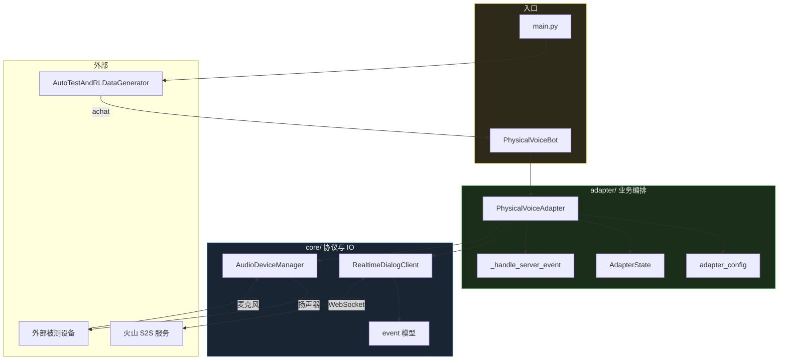
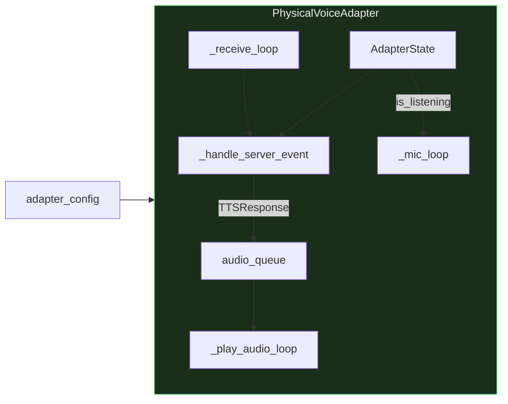
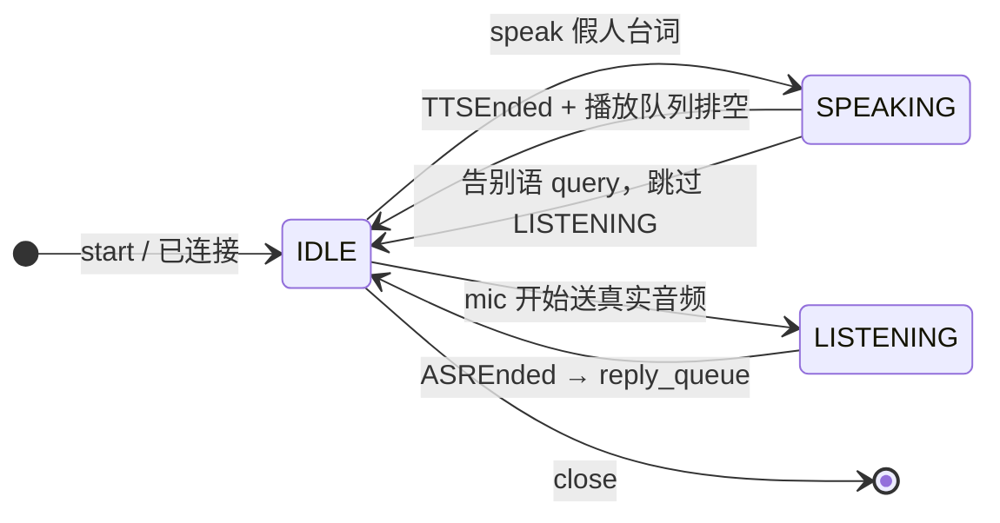

# 物理语音链路评测（voice_test）

通过火山 S2S，把**假人台词用扬声器播出去**，让**外部真实设备**（车机、音箱等）听到并回复，再用本机麦克风收音、ASR 识别，把文本交回 AutoTest 评测框架。

```
假人台词 ──TTS──▶ 扬声器 ──▶ 外部设备听到并说话
                                    │
本机麦克风 ◀──ASR── 火山 S2S ◀──────┘
     │
     └──▶ 评测框架拿到「助手回复」文本
```

> 本项目是**物理语音测试适配层**，不是通用 S2S SDK。底层协议在 `core/`，业务编排在 `adapter/`。

## 目录结构

```
projects/voice_test/
├── main.py                      # 评测入口（接 AutoTest 框架）
├── __init__.py                  # 导出 PhysicalVoiceBot / PhysicalVoiceAdapter
├── output/                      # 运行产物（git 忽略）
├── core/                        # 底层：协议、客户端、事件模型
│   ├── config.py                # 火山连接参数、StartSession 默认体、音频参数
│   ├── protocol.py              # 二进制帧封包/解包
│   ├── event.py                 # 服务端事件 Pydantic 模型 + parse
│   ├── realtime_dialog_client.py# WebSocket 客户端
│   └── audio_manager.py         # PyAudio 输入/输出流
└── adapter/                     # 业务层：物理语音适配
    ├── config.py                # VoiceAdapterConfig + adapter_config
    ├── voice_adapter.py         # 状态机、事件处理、编排、build_start_session_req
    └── physical_voice_bot.py    # 对接 AutoTest 的 Bot 适配
```

## 运行

```bash
# Linux / macOS
.venv/bin/python projects/voice_test/main.py

# Windows
python projects/voice_test/main.py
```

产物写入 `output/`（已在 `.gitignore` 中忽略）：

| 文件 | 说明 |
|------|------|
| `benz_demo_judge_log.txt` | 判分日志 |
| `benz_demo_report.md` | 评测报告 |

改唤醒词、超时、ASR 日志开关：编辑 `adapter/config.py` 里的 `adapter_config`。

## 分层关系



**依赖方向**：`main` → `adapter` → `core`，`core` 不依赖 `adapter`。

## adapter 模块说明

### 各文件职责

| 模块 | 文件 | 干什么 |
|------|------|--------|
| 配置 | `config.py` | `VoiceAdapterConfig` + 写死的 `adapter_config`（唤醒词、超时、告别语等） |
| 编排 | `voice_adapter.py` | `PhysicalVoiceAdapter`：建连、播 TTS、开麦、等回复；内含 `AdapterState`、`AsrEventPrinter`、`build_start_session_req()` |
| 适配 | `physical_voice_bot.py` | 实现评测框架需要的 `achat` / `adump_history` 等，内部持有一个共享 `PhysicalVoiceAdapter` |

### adapter 内部协作



`PhysicalVoiceAdapter` 启动后会跑三条并发路径：

1. **`_receive_loop`**：从 `RealtimeDialogClient` 收事件 → `_handle_server_event()`
2. **`_mic_loop`**：LISTENING 时送真实麦克风流，否则送静音保活
3. **`_play_audio_loop`**（线程）：从 `audio_queue` 取 PCM 写扬声器

`_handle_server_event` 处理评测关心的几类事件：

| 事件 | 行为 |
|------|------|
| `TTSResponse` | SPEAKING 阶段写入 `audio_queue` 播放 |
| `TTSEnded` | 通知 `AdapterState`，结束本次 TTS 等待 |
| `ASRFinal` | 累积识别文本到 `latest_asr_text` |
| `ASREnded` | 把最终文本放入 `reply_queue`，供上层 `speak_and_listen` 取回 |
| `ServerErrorResponse` | 抛错 |

`build_start_session_req()` 在 `voice_adapter.py` 中，按 `adapter_config.vad_timeout_ms` 等生成 StartSession 请求（自定义 VAD 窗口）。

### 一轮 `achat` 的状态流

评测框架每调一次 `achat(query)`，适配层完成「说一句、听一句」：



对应代码路径：

```
PhysicalVoiceBot.achat
  └─ PhysicalVoiceAdapter.speak_and_listen
       ├─ ensure_framework_session   # 评测 session 变了就重建火山连接
       ├─ speak                      # 首轮 SayHello+唤醒词，后续 ChatTTSText
       └─ _wait_external_reply       # LISTENING，等 reply_queue
```

首轮 SayHello 时会自动拼接 `adapter_config.wake_up_word`；终端会打印 `[唤醒词] …`（仅配置了非空唤醒词时）。

若用户台词命中 `goodbye_markers`（默认含「退下」「再见」「拜拜」），播完后直接返回 `goodbye_reply`，不再等车机 ASR。

### PhysicalVoiceBot 与 Adapter 的关系

`PhysicalVoiceBot` 很薄：维护对话 `turn_records`，每次 `achat` 转调 `PhysicalVoiceAdapter.speak_and_listen`。

全进程共享**一个** Adapter 实例（类变量 `_adapter`），避免重复占麦克风和 WebSocket。用例结束或进程退出时调用 `PhysicalVoiceBot.close_adapter()` 释放资源。

## core 模块（简要）

| 模块 | 说明 |
|------|------|
| `protocol.py` | 生成/解析火山二进制帧头与 payload |
| `event.py` | 把 `parse_response` 的 dict 转成具体事件模型（`TTSResponse`、`ASRFinal` 等） |
| `realtime_dialog_client.py` | 连接、StartSession、SayHello、ChatTTSText、送音频块、`receive_event()` |
| `config.py` | API 鉴权头、默认 TTS/ASR/对话配置、16k 入 / 24k 出音频参数 |
| `audio_manager.py` | 打开/关闭 PyAudio 输入输出流 |

## 对外 API

```python
from projects.voice_test import PhysicalVoiceBot, PhysicalVoiceAdapter
```

接入其它评测脚本时，把 `bot_to_test=PhysicalVoiceBot` 传给 `AutoTestAndRLDataGenerator` 即可。

## 配置项速查

`adapter/config.py` → `adapter_config`：

| 字段 | 默认 | 说明 |
|------|------|------|
| `wake_up_word` | `"你好奔驰"` | 首轮 SayHello 前缀 |
| `goodbye_markers` | `退下/再见/拜拜` | 命中后跳过 ASR |
| `vad_timeout_ms` | `2000` | ASR 静音判停窗口 |
| `external_reply_timeout_sec` | `60` | 等车机回复超时 |
| `log_asr_events` | `True` | 终端 ASR 日志 |
| `log_asr_delta` | `True` | 是否打印 ASR 增量 |

## 常见问题

**问：为什么首轮用 SayHello，后面用 ChatTTSText？**  
火山 Session 内 SayHello 只适合开场一次；多轮假人台词后续走 ChatTTSText，避免重复开场白。

**问：评测 framework 的 session_id 和火山 session 什么关系？**  
`framework_session_id` 变化时会 `close` 再 `start`，重置 `speak_index`，保证新 session 能再次 SayHello。

**问：ASR 日志在哪开？**  
`adapter/config.py` → `adapter_config.log_asr_events` / `log_asr_delta`。

**问：关闭时 WebSocket 已断连，为什么还能正常退出？**  
`PhysicalVoiceAdapter.close()` 在 `stop_session` / `stop_connection` 失败时会打印 `[voice_test] 关闭时连接已断开` 或 `[voice_test] 关闭失败`，不会静默吞错；后续仍会 cancel 任务并释放音频设备。
